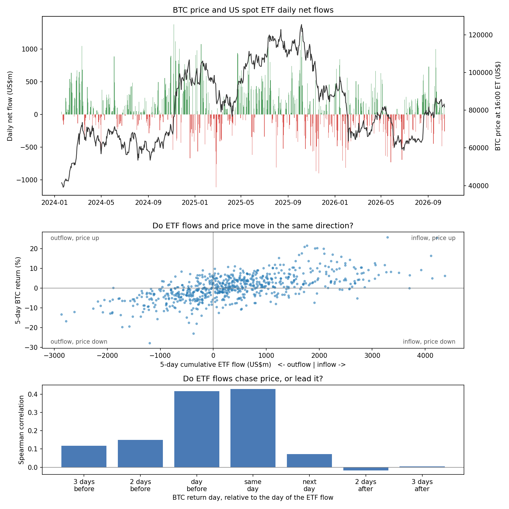
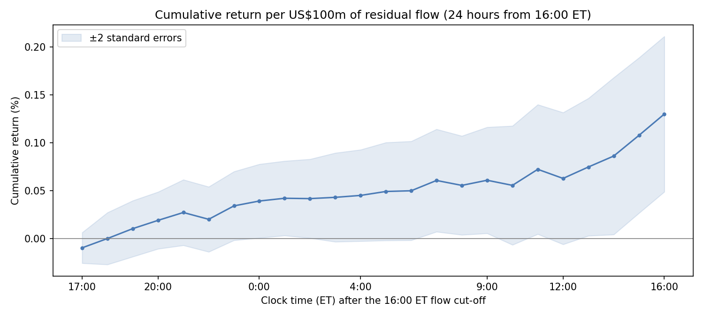

# US spot crypto ETF flows, stablecoins and a backtest yardstick

Code and results behind a series of research notes (published in Japanese on note.com) on US spot crypto ETF flows and BTC returns, and the evaluation protocol ("yardstick") used to judge backtests in later notes.

| Part | Question | Main result | Script |
| --- | --- | --- | --- |
| 1 | Do BTC ETF flows predict the next day's return? | Raw flows barely; the **residual flow** (flow not explained by recent returns and past flows) does: +0.17% per US$100m (t = 3.43) | `btc_etf_flow_analysis.py` |
| 2 | Does it replicate for ETH ETFs? | Partly: ETH residual flow loses significance once the BTC residual flow is controlled for; the information sits on the BTC side | `btc_etf_flow_analysis.py --asset ETH` |
| 3 | Does stablecoin supply (USDT, USDC) carry the same information? | No relation with the next-day BTC return; the ETF residual flow keeps its effect | `stablecoin_flow.py` |
| 4 | Are recent ETF outflows beyond what the equity sell-off predicts? | Not in the 20 trading days to 2026-10-16 | `flow_equity_check.py` |
| 5 | How should a backtest be judged? | Brute-forcing 432 meaningless rules: the best (a random rule) looks good, the yardstick rejects it | `yardstick.py` |
| 6 | Are the persistence baselines calibrated? | On no-edge i.i.d. and GARCH paths, all baseline constructions reject at about the nominal 5% | `persistence_null_demo.py` |

> Research notes, not investment advice. See the limitations of each part.

---

## Part 1. Raw flows don't predict, residuals do: 686 days of US spot Bitcoin ETF flows

### Data and method

| Item | Source | Details |
| --- | --- | --- |
| ETF flows | [Farside Investors](https://farside.co.uk/bitcoin-etf-flow-all-data/) | Total daily net flow of all US spot Bitcoin ETFs, US$m |
| BTC price | Coinbase Exchange API | BTC-USD, 1-hour candles |
| Sample | | 2024-01-19 to 2026-10-13, 686 trading days |

BTC trades 24/7, but ETF flows are aggregated per US trading day and every ETF strikes its NAV at **16:00 ET**. Prices are therefore aligned to that cut-off: the daily "close" is the BTC price at 16:00 ET, and the daily return $r_t$ runs from 16:00 ET on the previous trading day to 16:00 ET on day $t$. This keeps the price window and the flow-reporting window as close as possible.

All regressions use HAC (Newey–West, 5 lags) standard errors. Flow coefficients are reported per US$100m.

---

#### 1. Flows chase price



Daily flows are most strongly correlated with the **previous day's and the same day's** BTC return, and hardly at all with later returns.

| BTC return day relative to the flow | −3 | −2 | −1 | 0 | +1 | +2 | +3 |
| --- | --- | --- | --- | --- | --- | --- | --- |
| Spearman correlation | 0.119 | 0.151 | 0.417 | 0.427 | 0.073 | −0.018 | 0.005 |

- A 1% BTC rise on day $t-1$ is followed by about **+US$45m** of flow on day $t$ (t = 8.24).
- Raw flow explains only **0.9%** of the variance of the next day's return ($R^2 = 0.009$).
- The same-day correlation (0.43) cannot be given a causal direction: flows may move the price, or investors may buy after seeing the price rise.

Headlines of the form *"ETF inflows are a tailwind for BTC"* treat flows as a leading indicator. On average, the data say they are mostly a lagging one.

---

#### 2. Residual flow: the part price moves cannot explain

##### Model

Let $F_t$ be the daily net flow and $r_t$ the daily BTC return. The expected flow is a linear model of the same-day and three past returns and three past flows:

$$
\hat{F}_t = a + \sum_{k=0}^{3} b_k\, r_{t-k} + \sum_{k=1}^{3} c_k\, F_{t-k}
$$

and the residual flow is

$$
\varepsilon_t = F_t - \hat{F}_t .
$$

##### Estimation

The coefficients $a, b_k, c_k$ used for day $t$ are estimated on data up to day $t-1$ only (expanding window) and then applied to day $t$. $\hat{F}_t$ is therefore an **out-of-sample prediction** and $\varepsilon_t$ an **out-of-sample residual**. The first 120 days are used only for estimation, leaving 562 days for evaluation.

Note that the same-day return $r_t$ is a regressor, so $\hat{F}_t$ is conditional on the 16:00 ET price of day $t$; it is not a forecast made at the start of the day. $r_t$ is included deliberately: without it, the residual would still contain the reaction to today's price move, and any link with tomorrow's return could simply be the continuation of today's move rather than information specific to flows.

##### How much of the flow is explained?

The out-of-sample $R^2 = 1 - \mathrm{Var}(\varepsilon)/\mathrm{Var}(F)$ is **46.5%**. Adding the regressor groups one at a time (in-sample, full period):

| Regressors added | Increment in $R^2$ | Interpretation |
| --- | --- | --- |
| Returns, $t-1$ to $t-3$ | 20.6% | Clear trend-chasing |
| Same-day return, $t$ | 18.7% | Direction of causality unclear |
| Flows, $t-1$ to $t-3$ | 9.9% | Persistence of flows |
| **Total** | **49.1%** | |

Increments depend on the order in which groups are added. Unambiguous trend-chasing accounts for about a fifth of the variation; about half is explainable in total.

##### Result

| Predictor of next-day return | per US$100m | t | Spearman |
| --- | --- | --- | --- |
| Raw flow | +0.068% | 2.10 | 0.051 |
| Residual flow | +0.173% | 3.43 | 0.149 |

Removing the explainable part raises the coefficient about 2.5× and the rank correlation about 3×. The explainable half of raw flows dilutes whatever information flows carry about the next day.

##### Robustness

Early 2024 was dominated by large GBTC redemptions, so the test was repeated from January 2025: **+0.176% per US$100m (t = 3.05, 317 days)**, essentially unchanged. This subsample is part of the full sample, so it is not an independent replication.

---

#### 3. When does the effect show up?

The next-day return is split at 09:00 ET into an overnight and a daytime segment:

| Segment | Residual flow | t | Raw flow | t |
| --- | --- | --- | --- | --- |
| Overnight (16:00 → next 09:00 ET) | +0.090% | 2.30 | +0.059% | 2.26 |
| Daytime (09:00 → 16:00 ET) | +0.083% | 2.96 | +0.025% | 1.23 |
| Total | +0.173% | 3.43 | +0.084% | 2.68 |

*Per US$100m.*

The question is whether the effect is only a **reporting-timing artefact**: when an ETF receives inflows, authorised participants buy spot BTC, and part of that buying can happen after the 16:00 ET cut-off. If that were the whole story, the effect would be concentrated overnight.

It is not: **52%** of the residual-flow effect appears overnight and the rest during the next US session. The daytime effect is insignificant for raw flow (t = 1.23) but significant for residual flow (t = 2.96).



Hour by hour, the effect builds up slowly overnight and rises again from early afternoon into 16:00 ET the next day. The afternoon rise may reflect ETF-related trading into the next NAV strike, but that remains a hypothesis. The x-axis is clock time, so for Friday flows the profile runs to Saturday 16:00; the 24-hour coefficient (+0.130%, t = 3.21) therefore differs from the next-trading-day total in the table (+0.173%).

---

#### 4. "Outflow but price up" divergences

A *divergence day* has a negative 5-day cumulative flow but a positive 5-day return. On average, returns over the following 5 days were weaker after divergences, but the difference is well within what chance produces.

| Mean return over the next 5 days | Full sample | Since 2025 |
| --- | --- | --- |
| After divergence days | −1.14% | −1.10% |
| Other days | +0.68% | −0.08% |
| Difference | −1.82% | −1.01% |
| p-value | 0.23 | 0.44 |

There were 54 divergence days, but they cluster into only 34 episodes, and the forward 5-day windows of neighbouring days overlap. The effective sample is much smaller than 54, and a plain t-test would overstate precision. Instead, the calendar pattern of divergence days was shifted circularly at random 5,000 times, keeping its clustering. In 23% of the shifted, "fake" patterns the difference was at least as large as observed (in either direction); since 2025, 44%. Divergences do not provide a reliable signal that a rebound will fail.

---

### Conclusion

Raw spot-ETF flows barely predict the next day's BTC return, because about half of their variation is explained by recent price moves and past flows. The residual — flow beyond what price moves explain — is associated with +0.17% per US$100m the next day, realised roughly half overnight and half in the next US session. Daily flows are better read as *"how much above (or below) what recent price action would explain"* than as a headline dollar amount.

### Limitations

- **Small explanatory power.** Most of BTC's daily movement is unrelated to ETF flows.
- **Not necessarily tradable.** Depending on when Farside data become complete, part of the next-day effect may occur before the data are public.
- **Model choice.** The expected-flow model (three lags, linear) is one choice among many; other lag lengths have not yet been tested.
- **Order dependence.** The $R^2$ decomposition depends on the order in which regressor groups are added.
- **Divergences.** No statistically reliable conclusion about what follows "outflow but price up" episodes.

Planned next steps: robustness to lag length and sample period, and differences across individual ETFs (IBIT, FBTC, …).

---

---

## Part 2. ETH ETFs: the information is on the BTC side

Sample from 2025-01-01 (442 trading days, 318 evaluated; the start date was fixed before looking at ETH results).

| Next-day return regressed on | ETH residual flow | t | BTC residual flow | t |
| --- | --- | --- | --- | --- |
| ETH next day, ETH alone | +0.428% | 2.58 | | |
| ETH next day, ETH + BTC | +0.272% | 1.46 | +0.196% | 2.12 |
| BTC next day, BTC + ETH | +0.048% | 0.55 | +0.164% | 2.66 |

*Per US$100m; HAC (5 lags) t.* The BTC residual flow keeps its association with the next-day return when the ETH residual flow is controlled for; the reverse does not hold. With a Bonferroni correction for the secondary tests, the BTC-to-ETH association (p ≈ 0.034) is significant only before the correction.

## Part 3. Stablecoin supply and the next-day BTC return

Daily changes in USDT + USDC circulating supply (DefiLlama), aligned so that only snapshots known before 16:00 ET are used, from 2025 (442 trading days).

| Next-day BTC return on | USDT + USDC | USDC only |
| --- | --- | --- |
| Residual supply change (one-sided p) | −0.005% (p = 0.59) | −0.055% (p = 0.94) |
| ETF residual flow, controlling for supply (two-sided p) | +0.175% (p = 0.003) | +0.177% (p = 0.002) |

*Per US$100m.* Only about 15% of supply changes is explained by price moves and past changes (ETF flows: about 45%).

## Part 4. Recent outflows vs. the equity sell-off

The Part 1 flow model is extended with same-day S&P 500 and SOX returns and the change in VIX (all at the 16:00 ET close; chosen before looking at the results). Over the 20 trading days 2026-09-21 to 2026-10-16: flow +US$1,720m, model prediction +US$1,986m, residual −US$267m, at the 55th percentile of the 525 past 20-day windows. Adding the equity terms raised the out-of-sample R² only from 46.2% to 46.6%. The residual is what the model did not predict, not flow that no information could predict.

## Part 5. Backtest yardstick

Seven checks used by every later note: timestamp alignment, walk-forward with purge/embargo, a full trial log, the Deflated Sharpe Ratio (Bailey & López de Prado, 2014) with an effective number of trials, block-bootstrap intervals, transaction costs, and evaluation against buy-and-hold (active return / information ratio).

Brute force over 432 rules (72 moving-average crossovers, 300 random long/flat rules), BTC-USD daily, 2022-07-21 to 2026-10-15, 10 bp per unit turnover (`--start 2022-01-01 --end 2026-10-15 --legacy-random` reproduces the published numbers):

| Best rule (a random rule) | Absolute return | vs. buy-and-hold |
| --- | --- | --- |
| Sharpe / information ratio | 1.38 | 0.17 |
| PSR (no trial adjustment) | 0.998 | 0.634 |
| DSR, 432 trials | 0.736 | 0.056 |
| DSR, effective trials 211 | | 0.075 |

Walk-forward selection (365-day training, 90-day test, 13 windows): out-of-sample Sharpe 0.62 vs. 0.93 for buy-and-hold on the same days; 11 different rules picked. `--selftest`: on simulated data the DSR never passed a no-edge best-of-100 rule but detected a true annual Sharpe of 2 in only 14% of runs — conservative, with low power.

Optional analyses in `yardstick.py`: rank-correlation persistence of rules between training and test windows against a block-shuffle baseline (`--persistence-null N`), a drift check (exposure x drift vs. timing, appraisal ratio), other assets (`--product ETH-USD`), and classification of walk-forward windows by externally supplied event dates (`--onsets`, `--episodes`; such files are not included in this repository).

## Part 6. Calibrating the persistence baseline

`persistence_null_demo.py --calibrate` builds the persistence baseline from one observed path in several ways (block bootstrap with replacement; block shuffle without replacement, blocks 1/20/60) and compares it with the true distribution on 200 independent no-edge paths. With 100 observed paths x 100 baseline paths, all constructions flagged "reversal" at about the nominal 5% under both i.i.d. and GARCH(1,1) returns (the largest, 8%, for the 20-day block bootstrap under GARCH; binomial s.e. 2.2%). Runs with 25-40 paths had suggested much larger error rates: small calibrations can mislead.

`mean_reversion_check.py` checks whether a price series mean-reverts (ADF, KPSS, variance ratio, OU half-life against random walks of the same length) before an Ornstein-Uhlenbeck process is fitted to it.

---

## Reproduce

```bash
pip install -r requirements.txt

# Flows (or save the pages from a browser and use --html)
python src/farside_to_csv.py --asset BTC     # -> data/farside_btc_flows.csv
python src/farside_to_csv.py --asset ETH     # -> data/farside_eth_flows.csv

# Part 1: BTC (fetches Coinbase hourly candles; writes figures/)
python src/btc_etf_flow_analysis.py --asset BTC --flows data/farside_btc_flows.csv
# Part 2: ETH, controlling for the BTC residual flow
python src/btc_etf_flow_analysis.py --asset ETH --flows data/farside_eth_flows.csv \
    --control-flows data/farside_btc_flows.csv --start 2025-01-01
# Part 3: stablecoin supply (DefiLlama)
python src/stablecoin_flow.py --etf-flows data/farside_btc_flows.csv --start 2025-01-01
python src/stablecoin_flow.py --etf-flows data/farside_btc_flows.csv --start 2025-01-01 --coins USDC
# Part 4: recent outflows vs. equities (Yahoo Finance for ^GSPC, ^SOX, ^VIX)
python src/flow_equity_check.py --flows data/farside_btc_flows.csv --recent 20
# Part 5: yardstick
python src/yardstick.py --selftest
python src/yardstick.py --start 2022-01-01 --end 2026-10-15 --legacy-random
python src/yardstick.py --product ETH-USD --start 2022-01-01 --end 2026-10-15 --legacy-random --persistence-null 200
# Part 6: baseline calibration (hours on one core; use --jobs)
python src/persistence_null_demo.py --calibrate --n-obs 100 --n-sim 100 --jobs 16 --out data/calib
python src/mean_reversion_check.py --demo

# Offline demos with synthetic data
python src/btc_etf_flow_analysis.py --demo
python src/flow_equity_check.py --demo
python src/yardstick.py --demo
```

```
.
├── README.md
├── requirements.txt
├── src/
│   ├── farside_to_csv.py          # Farside "All Data" tables (BTC / ETH) -> daily CSV
│   ├── btc_etf_flow_analysis.py   # Parts 1-2: residual flow, figures (BTC or ETH, optional control asset)
│   ├── stablecoin_flow.py         # Part 3: stablecoin supply changes vs. ETF residual flow
│   ├── flow_equity_check.py       # Part 4: recent flows vs. a model with equity factors
│   ├── yardstick.py               # Part 5: backtest-reliability protocol
│   ├── persistence_null_demo.py   # Part 6: calibration of persistence baselines
│   └── mean_reversion_check.py    # mean-reversion checks before fitting an OU process
├── data/                          # downloaded data and outputs (not committed)
└── figures/                       # generated figures
```

### Core function: residual flow

```python
def flow_residual(df, p=3, min_obs=120):
    """Out-of-sample residual flow eps_t = F_t - Fhat_t (coefficients fit on days < t)."""
    X = pd.concat({f"ret_l{k}": df["ret"].shift(k) for k in range(0, p + 1)} |
                  {f"flow_l{k}": df["flow"].shift(k) for k in range(1, p + 1)}, axis=1)
    X.insert(0, "const", 1.0)
    y = df["flow"]
    ok = X.notna().all(axis=1) & y.notna()
    Xv, yv, idx = X[ok].to_numpy(), y[ok].to_numpy(), X[ok].index
    resid = pd.Series(np.nan, index=df.index)
    for i in range(min_obs, len(yv)):
        beta, *_ = np.linalg.lstsq(Xv[:i], yv[:i], rcond=None)   # fit on days < t
        resid.loc[idx[i]] = yv[i] - Xv[i] @ beta
    return resid
```

`df` holds the daily flow (`flow`, US$m) and the 16:00 ET log return (`ret`).

---

## Data sources and disclaimer

- ETF flows: [Farside Investors](https://farside.co.uk/bitcoin-etf-flow-all-data/). Farside notes that its data contain estimates and may contain errors. Raw data are not redistributed in this repository.
- Crypto prices: Coinbase Exchange public API (BTC-USD, ETH-USD, 1-hour candles).
- Stablecoin supply: DefiLlama stablecoins API.
- Equity indices: Yahoo Finance (^GSPC, ^SOX, ^VIX).

This repository is for research and educational purposes only and does not constitute investment advice.
